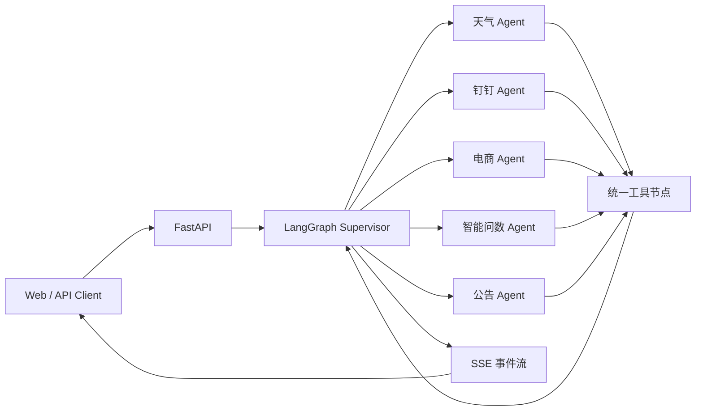

# 智枢 · 多智能体协作平台

面向企业多业务场景的统一 Agent 入口。平台以 LangGraph supervisor 为核心，将天气查询、钉钉办公、电商导购、智能问数和公告等能力编排为可注册、可追踪、可人工确认的子智能体。

[](https://www.python.org/)
[](https://fastapi.tiangolo.com/)
[](https://langchain-ai.github.io/langgraph/)
[](https://modelcontextprotocol.io/)
[](https://a2a-protocol.org/)

## 项目概览

多智能体系统真正的工程难点并不只是“把多个 Agent 放在一起”，而是让一个统一入口在日常业务中稳定运行：路由结果要可见，跨会话上下文不能丢失，写操作必须经过用户确认，模型质量、响应时延与调用成本需要持续评估。

本项目围绕这些目标实现：

- 以 supervisor 状态图完成意图路由与工具调用循环。
- 通过注册表接入子智能体，新增业务线无需修改编排器核心代码。
- 对外统一 SSE 事件契约，前端能够还原路由轨迹与执行过程。
- 使用 interrupt + checkpoint 实现 human-in-the-loop 写操作确认。
- 结合短期记忆、长期记忆、Reflection、Replanning 与 Reflexion 提升执行稳定性。
- 接入 MCP、A2A、LangSmith、Prometheus、RAGAS 与离线黄金用例。

## 核心能力

### 1. 多智能体编排



超级节点根据当前注册表动态生成工具列表和系统提示词。同名配置可覆盖旧配置，因此新增业务线只需注册适配器，无需改动 supervisor 的图结构。

### 2. 人工确认与状态恢复

发消息、创建待办、发送 DING 等写操作不会直接执行。编排器先触发 `confirm_required`，前端展示确认卡片；用户确认后，系统从 checkpoint 恢复原状态继续执行。

### 3. 统一事件契约

通过 SSE 对外输出过程事件：

| 事件 | 含义 |
| --- | --- |
| `agent_call` | supervisor 将任务转交给指定子智能体 |
| `agent_result` | 子智能体返回结果 |
| `text` | 最终回答或流式文本 |
| `confirm_required` | 写操作等待用户确认 |
| `done` | 本轮执行完成 |

前端可以据此展示“谁处理了请求、调用了多久、是否成功”，而不需要在 UI 中重新推断后端的路由逻辑。

### 4. 记忆与上下文工程

- 短期记忆基于 LangGraph Checkpointer，支持内存、Redis 与 PostgreSQL，并在依赖缺失时自动回退。
- 长期记忆按事实、偏好与事件进行结构化提取和落库。
- 召回阶段综合时间衰减、重要性与召回频率，并结合截断、Token 预算与摘要压缩控制上下文成本。

### 5. 智能问数安全链路

自然语言问数遵循“生成 SQL → 只读校验 → 执行 → 中文解读”的完整链路，并通过多层防护降低误写与越权风险：

- 提示词只暴露非敏感表结构。
- 守卫层拒绝写操作、多语句和敏感列，并强制补充 `LIMIT`。
- 执行层使用只读事务、`statement_timeout` 与 `asyncio` 超时。
- SQL 报错可回到生成节点自动修正，最多重试两次。

### 6. 可观测、评估与自纠错

- 自建 Trace、Metric、Log 三层观测，并同时接入 LangSmith。
- 统计轮次、错误率、延迟分位数、Token 与估算成本，导出 Prometheus 指标。
- 使用黄金用例评估完成率、工具选择准确率、冲突率、延迟和成本。
- RAG 链路通过 RAGAS 与 LLM-as-Judge 做离线评估。
- 实现 Reflection、Replanning 和 Reflexion 三类反思机制。

## 交付成果

- 5 个零构建前端：多智能体控制台、智能问数、电商导购与实时语音、钉钉助手、天气出行。
- 59 个 API 路径与 2 个 MCP 服务。
- 131 个源文件通过 mypy，Ruff 零告警。
- 81 个测试用例通过，覆盖编排事件契约、确认闭环、只读守卫、语音链路和前端页面。

## 技术栈

| 领域 | 技术 |
| --- | --- |
| Web | FastAPI、Pydantic v2、SSE、WebSocket |
| Agent | LangChain、LangGraph、supervisor、Checkpointer |
| 协议 | MCP、FastMCP、Streamable HTTP、A2A、a2a-sdk |
| 数据 | PostgreSQL、pgvector、Milvus、Redis、SQLAlchemy 2.0 Async |
| 模型 | DeepSeek、DashScope `text-embedding-v4`、Qwen3-ASR、Qwen-TTS |
| 可观测 | LangSmith、Prometheus、RAGAS、LLM-as-Judge |
| 工程化 | Docker Compose、Nginx、uv、Ruff、mypy、pytest |

## 快速开始

### 1. 安装依赖

```bash
uv sync --group dev
```

### 2. 配置环境变量

```bash
copy src/.env.example src/.env
```

按需填写 PostgreSQL、Redis、DeepSeek、DashScope、天气、钉钉与 OSS 等配置。仓库不会提交真实 `.env`。

### 3. 启动服务

```bash
uv run python src/run.py
```

没有外部基础设施时，可以先预览接口：

```bash
uv run python src/run.py --skip-infra
```

默认地址：

- API 文档：`http://127.0.0.1:8000/docs`
- 健康检查：`http://127.0.0.1:8000/api/v1/health`

### 4. 运行测试

```bash
uv run pytest -q
uv run ruff check .
uv run mypy src
```

### 5. Docker Compose

```bash
docker compose up -d
```

## 目录结构

```text
.
├── src/
│   ├── app/
│   │   ├── api/v1/           # 编排、认证、天气、电商、钉钉、问数、观测等接口
│   │   ├── core/agents/      # 子智能体、注册表、编排器、A2A 与反思模块
│   │   ├── core/             # 配置、数据库、安全、记忆和可观测性
│   │   ├── rag_evaluation/   # RAG 离线评估
│   │   ├── agent_evaluation/ # Agent 黄金用例评估
│   │   └── static/           # 5 个零构建前端
│   └── mcp_serves/           # MCP 工具服务
├── tests/                    # 单元、契约、前端与评估测试
├── docs/                     # 架构与设计文档
└── docker-compose.yml
```

## 安全说明

- `.env`、本地日志、缓存、虚拟环境与密钥文件均已排除。
- 公开仓库只包含 `.env.example`，其中全部为占位值。
- 写操作接入确认机制，SQL 执行接入只读守卫与超时控制。

## 作者

杨磊 · [GitHub](https://github.com/spring5-20) · [个人主页](https://github.com/spring5-20)
